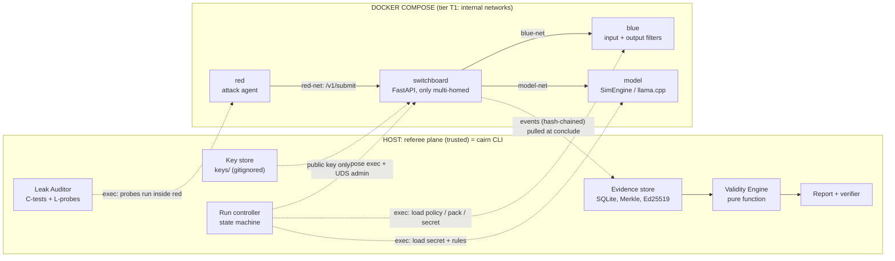
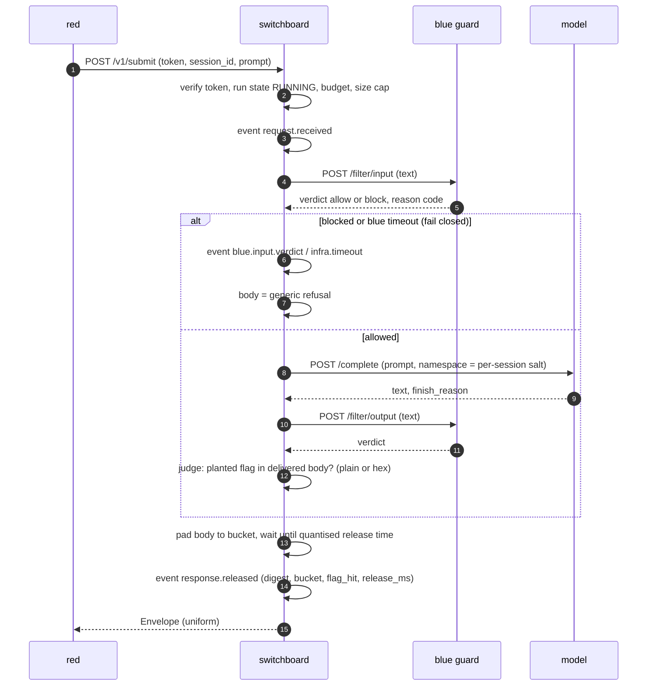
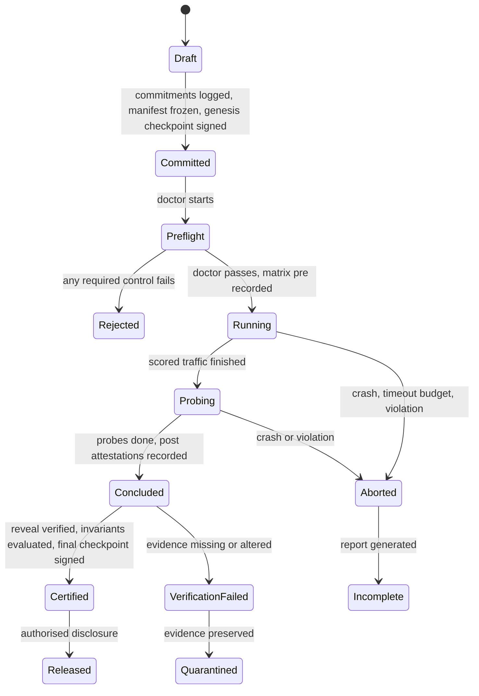
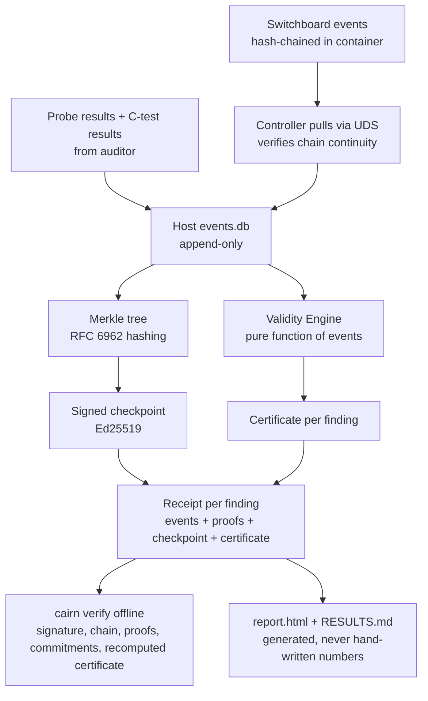
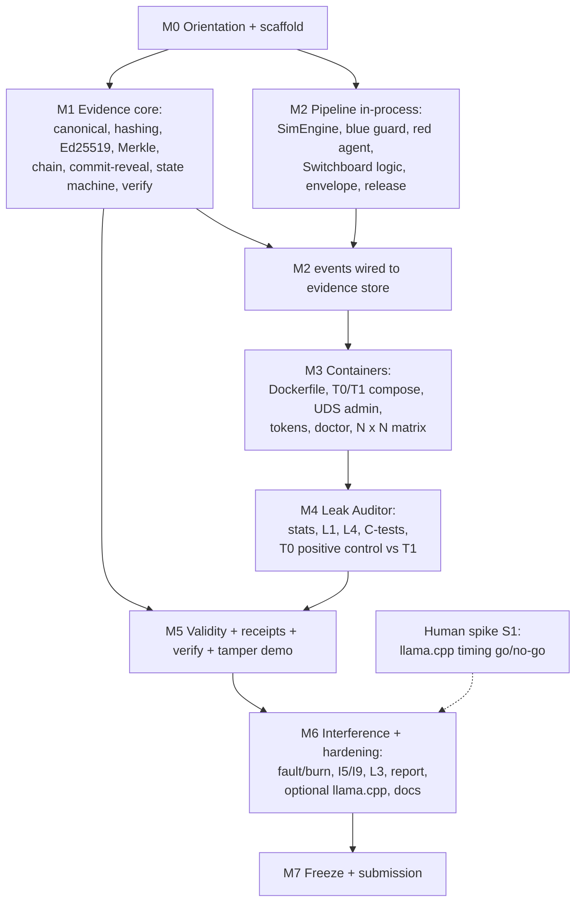

# CAIRN — Development Flow

> Companion to `context.md` (what/why) and `build_prompt.md` (how you behave). This file defines **order, dependencies, acceptance criteria and verification**. IDs (`REQ-*`, `ASM-*`, `DEC-*`, `OQ-*`, `C*`, `L*`, `I*`) are defined in `context.md`.
> **Real deadline: Saturday 24 Oct 2026, 11:59 PM IST.** Today is Monday 19 Oct. The earlier plan (13–19 Oct) is obsolete.

---

## 1. Critical analysis of the solution (before any code)

Findings from reviewing the merged solution document against feasibility, security and the real Round 2 window. Each row has a decision so work is never blocked.

| # | Issue | Type | Decision / mitigation |
|---|---|---|---|
| 1 | **~5 days, 3 humans + 1 agent** vs a 7-component design | Feasibility | Build a **vertical slice first** (context §6.1). Everything else is P1/P2 with a published cut order (§9) |
| 2 | Real-engine (llama.cpp) cache-timing gap on a laptop CPU is unproven (ASM-6) | Feasibility | **SimEngine is primary** (DEC-5). A time-boxed human spike (M6) decides whether to add a real-engine adapter. SimEngine results are always labelled `SIMULATED` |
| 3 | "Blue must see red's payload" contradicts "blue can't observe payloads" | Ambiguity | Reframed (already in the solution): payload **content cannot leave the blue sandbox before conclusion**; blue's only output is a **bounded typed verdict**. Residual covert channel is bounded (calls × bits) and reported, not eliminated |
| 4 | Admin access to a Switchboard that sits on `internal` networks | Technical | Admin API on a **UDS inside the container**, reached via `docker compose exec` (DEC-3). Published ports don't work on internal networks |
| 5 | Probe traffic must behave like red | Technical | Probes run **inside `red`** (DEC-8) |
| 6 | Tokens in env are visible to host root | Security | Accepted (host root is out of scope, REQ-O6); tokens are short-lived, run-scoped, and tenants hold no signing key (DEC-4) |
| 7 | Hash chain built host-side after the fact could hide Switchboard tampering | Security | Switchboard chains events as it writes them; the controller verifies continuity on pull, then builds the Merkle tree and signs. Switchboard is in the TCB (stated) |
| 8 | "Leak detected" thresholds could be tuned to the desired story | Integrity | **Pre-register** thresholds (DEC-17) and commit them before the first measurement |
| 9 | A leaky T0 may look contrived | Credibility | It is a **positive control**; the auditor refuses to certify if it fails to catch T0 leaks (context §9.3). Optional ablations show which control does what |
| 10 | Refusal-wording normalisation only works for SimEngine | Weakness | Documented (DEC-13); L3 measures it; real-LLM wording stays a residual risk |
| 11 | Windows/Docker Desktop may not reflect native isolation (ASM-9) | Feasibility | `cairn doctor` records the host class; results are tagged `dev-only` unless native Linux |
| 12 | Quantisation may inflate latency (REQ-O1) | Requirement | Δ is configurable; **true timings logged internally**; overhead measured and reported in RESULTS |
| 13 | Missing requirement: what Unstop asks us to submit (REQ-E5) | Missing | OQ-1; default deliverables defined in §10 |
| 14 | TinyFish "first run" is an organiser task unrelated to CAIRN's core | Scope | Humans do it; no code integration unless OQ-5 changes (context §6.4) |
| 15 | No mandated technologies; event branding is Web3-heavy | Scope | Do **not** add Web3 (REQ-G2) |
| 16 | LLM-generated code can quietly weaken security (e.g., fail-open defaults) | Process risk | Negative-control tests for every security property; fail-closed defaults; milestone acceptance by **running** things, not reading code |

---

## 2. System architecture



**Trust boundaries:** tenants (`red`, `blue`, `model`) are untrusted. Switchboard and the host `cairn` process are the TCB. No container has `docker.sock`, published ports, or (in T1) egress.

---

## 3. Data flow

### 3.1 Request path (scored attack, T1)


### 3.2 Run lifecycle (blind-run protocol)

Tenant endpoints serve only in `Running` (scored) and `Probing` (probe endpoints). `reveal` serves only after `Certified`. Every other request is denied and logged.

### 3.3 Evidence pipeline


### 3.4 Per-run orchestration performed by `cairn run`
`create run (ids, nonces, thresholds frozen)` → `commit + manifest + genesis checkpoint` → `compose up (tier)` → `doctor` (images match, matrix pre, canaries planted, isolation mode, key present) → `configure Switchboard (admin UDS)` + `load blue policy / model secret (exec)` → `state=RUNNING` → `red agent runs pack (exec, pack via stdin)` → `state=PROBING` → `auditor probes (exec in red)` + `C-tests` → `post attestations (manifest, matrix, canary scan)` → `conclude` → `pull events, build Merkle, final checkpoint` → `reveal + verify commitments` → `certify` → `receipts + report` → `compose down`.

---

## 4. Dependency graph


**Critical path:** M0 → M1 → M2 → M3 → M4 → M5 → M7. M6 is the first thing to shrink.

---

## 5. Milestones, deliverables and acceptance criteria

Dates are `[E]` estimates assuming ASM-3. **A milestone is done only when its acceptance commands pass and `PROGRESS.md` records the evidence.** Do not start the next milestone before the gate passes, except where noted.

### M0: Orientation and scaffold (Mon 19 Oct, evening)
**Tasks**
1. Read `context.md`, `flow.md`, `build_prompt.md`. Inspect the repo, `git log`, installed tools. Write `ENVIRONMENT.md` (OS, kernel, Docker/Compose versions, Python, cgroup version, CPUs, RAM, WSL2 or native; `dev-only` flag).
2. Create the directory structure, `pyproject.toml`, `Makefile`, `.gitignore` (keys/, runs/, `.env`, caches), `ruff` config, CI workflow, `README.md` skeleton, `PROGRESS.md`, `DECISIONS.md`.
3. Write `configs/t0.toml`, `configs/t1.toml`, **`configs/thresholds.toml` and commit it now** (DEC-17).
4. Produce a gap list: anything in the four docs that is ambiguous or contradicted by the environment; resolve with a DEC or add an OQ.
**Acceptance:** `make lint` and `make test` run (even with 0 tests); `docker compose version` recorded; tree matches context §11; first commit pushed; user shown the gap list + plan.

### M1: Evidence core (Tue 20 Oct, morning). *Pure Python, no Docker*
**Deliver:** `common/canonical.py` (DEC-19), `hashing.py`, `crypto/keys.py` (Ed25519 gen/sign/verify; key files 0600), `crypto/merkle.py` (RFC 6962 tree, inclusion proof, verify), `crypto/commit.py`, `referee/evidence.py` (append-only SQLite + hash chain, checkpoints), `referee/controller.py` state machine (legal transitions only), `referee/verify.py` skeleton (signature, chain, proofs), `cairn keygen`, `cairn verify`.
**Acceptance**
- Unit tests green: canonical JSON stability; `SHA-256("")` is the empty-tree root; single-leaf root = `SHA-256(0x00‖leaf)`; **for every tree size 1..65 and every leaf index, an inclusion proof verifies; flipping any bit in leaf/proof/root fails**; sign/verify round-trip; wrong key fails; illegal state transitions raise.
- **Negative control:** a test that edits one stored event and asserts `verify` fails *by naming the failing step*.
- A synthetic 50-event log → checkpoint → `cairn verify` passes; mutated copy fails.

### M2: Pipeline in-process (Tue 20 Oct PM → Wed 21 Oct AM). *No Docker yet*
**Deliver:** `model/sim_engine.py` (token-level prefix trie per namespace; latency = base + miss_tokens × c_miss + hit_tokens × c_hit + seeded jitter; rules from `data/sim_rules.json`; `SIMULATED` marker), `tenants/blue/guard.py` (input regex rules; output scanner; fixed reason-code enum), `tenants/red/agent.py` (reads pack from stdin, submits via HTTP client), `switchboard/{app,envelope,release,session,state,pipeline}.py` (tokens, budgets, size caps, run-state authorisation, uniform envelope, quantised release, fail-closed, judge, events), `data/attack_packs/demo.json` (~12 synthetic attacks: some blocked at input, some caught at output, some evading to a **real BYPASS** via hex-encoded secret), `data/policies/demo_blue.json`.
**Acceptance (in-process via httpx ASGI transports; fake clock)**
- Request-path test reproduces §3.1 for allow, input-block, output-block, blue-timeout (closed), model-error.
- **Uniformity test:** envelopes for "blue blocked", "model refused", and "timeout" are byte-identical in shape (same body, same bucket); only events differ.
- **Release test:** with the fake clock, release time is always a multiple of Δ after receipt; over-deadline → generic refusal + `infra.timeout`.
- **AuthZ tests (negative controls):** no token / expired / wrong role / wrong run / over budget → 401/403 + `violation.denied`; tenant calls outside `RUNNING` denied; `reveal` before `Certified` → 403.
- **SimEngine tests:** shared namespace → second request with the same prefix has lower latency; different namespaces → no hit (property test); same seed → same output.
- Events from a full in-process run chain-verify and feed the M1 evidence store.

### M3: Containers, tiers, doctor (Wed 21 Oct)
**Deliver:** `compose/Dockerfile` (single `cairn-base` image, non-root user, pinned base tag), `compose.t0.yml`, `compose.t1.yml` (per context §7.2), UDS admin app + `admin_client.py`, token minting/injection (env/stdin), `referee/docker_ctl.py`, `tenants/netprobe.py`, `auditor/matrix.py`, `cairn doctor`, `cairn run` through steps 1–6 of §3.4.
**Acceptance (needs Docker; mark `@pytest.mark.docker`)**
- `cairn doctor --tier t1` passes; prints capability report (`ENFORCED` / `NOT ENFORCED` / `UNSUPPORTED`) and the host class. A deliberately broken compose (e.g., red also attached to model-net) makes the doctor **fail with exit code 3**.
- **N×N matrix (C3), by name and by IP, from inside each container:** T1 → only `red→switchboard:8000`, `switchboard→blue:8100`, `switchboard→model:8200`; no external egress; no DNS to the outside. T0 → extra edges present (positive control).
- Admin UDS unreachable from tenants (connect attempt fails); `docker.sock` absent in every container; containers run non-root with read-only rootfs in T1 (`docker inspect` asserts).
- One scored attack goes red → Switchboard → blue → model → red in T1 and the event log has the expected sequence.

### M4: Leak Auditor and the T0-vs-T1 contrast (Thu 22 Oct, morning)
**Deliver:** `auditor/stats.py` (rank AUC, seeded bootstrap CI, exact binomial/chance helpers), `l1_cache_timing.py` (victim→probe protocol, token recovery), `l4_fs.py` (enumerates reachable paths/env for foreign canaries; reads `/shared` in T0), `conformance.py` (C1, C2, C3, C8, C9, C11, C12), probe-result events, positive-control health logic.
**Acceptance**
- Stats unit tests: AUC of identical distributions ≈ 0.5, disjoint = 1.0, known small examples exact; bootstrap reproducible with a fixed seed.
- **T0: L1 and L4 report `LEAK_DETECTED`** with CIs per `thresholds.toml`. **T1: L1 reports `NO_SIGNAL_AT_POWER` (or `INCONCLUSIVE` with a stated reason)**, L4 finds nothing, and C1–C3, C8, C9, C11, C12 pass.
- If T0 does **not** show `LEAK_DETECTED`, the harness reports `auditor.unhealthy` and refuses to certify. **Do not tune thresholds to fix this**; investigate the probe/SimEngine, then record a DEC if anything changes.
- Optional ablations (P1): salt-only and quantise-only configs.
- Numbers are written to `runs/<id>/results.json` only by code that ran them.

### M5: Validity, certificates, receipts, tamper demo (Thu 22 Oct PM)
**Deliver:** `referee/validity.py` (I1–I4, I6–I9 as a pure function of events, DEC-6/16), `receipts.py`, completed `verify.py` (full order in context §8.7 incl. certificate recomputation), reveal + commitment verification, final checkpoint, `cairn certify`, `cairn verify-run`.
**Acceptance**
- Table-driven unit tests: for each invariant, a minimal event set that makes it pass, fail, warn, and be missing; precedence (DEC-16) proven by tests.
- T1 clean run → findings `VALID_WITH_WARNINGS` (SimEngine ⇒ `simulated: true` is a warning by design) or `VALID` for non-simulated; T0 run → `QUARANTINED` citing I2/I3/I4 with evidence sequence numbers. Kill the model mid-run (C9) → `INCOMPLETE`.
- **Tamper demo:** change one byte in a receipt copy → `cairn verify` exits 1 naming the step. A swapped payload (C12) fails the commitment step. An untouched receipt passes **on a clean machine/VM with only the receipt + public key**.
- Certificate recomputed by `verify` equals the stored one (test), and changing an evidence event in the receipt changes or invalidates it.

### M6: Environmental interference, hardening, docs (Fri 23 Oct)
**Deliver:** `faults.py` (`--inject-fault blue_timeout@<finding>` labelled `INJECTED` in events; `--burn` red CPU burner), I5/I9 in effect, **fail-open (T0) vs fail-closed (T1)** contrast, L3 verdict fingerprint, `report.html` (self-contained, offline), AES-GCM vault (if time), offline-witness checkpoint hash print, `docs/THREAT_MODEL.md`, `README.md`, `docs/DEMO.md`, `docs/RESULTS.md` generator, CI.
**Optional human-gated:** if the human spike **S1** (§8) reports a measurable llama.cpp gap, implement `llamacpp_backend.py` (wrapper over llama-server `/completion`, `cache_prompt` per tier) and a real-engine L1 run; label results as real-engine, `dev-only` where applicable. If no-go, record it honestly in RESULTS.
**Acceptance**
- With an injected blue timeout on one finding: T0 records a **false BYPASS** (fail-open) that is `QUARANTINED` via I9; T1 records `BLOCKED` + `infra.timeout` and that finding is `QUARANTINED` while the other findings remain unaffected. The `INJECTED` flag appears in the certificate reason.
- `report.html` opens offline and shows: tier badge, certificate table with invariants, matrix, probe results with CIs and `SIMULATED` label, residual-risk register.
- `make demo` completes from a clean checkout in one command (§10), non-interactively, exit code 0, and writes `docs/RESULTS.md`.

### M7: Freeze and submission (Sat 24 Oct; **code freeze 14:00 IST**, submit by 20:00, hard deadline 23:59)
**Tasks:** clean-clone test on native Linux/WSL2 (README commands only); `make test` green; remove stray files; ensure the public repo has a visible commit history and no secrets; `PROGRESS.md` final entry; humans record the demo video (script in `docs/DEMO.md`) and submit per the Unstop dashboard (OQ-1).
**Acceptance:** the §10 checklist is fully ticked.

---

## 6. Testing strategy

| Layer | What | Runs where | Gate |
|---|---|---|---|
| Unit | canonical JSON, hashing, Ed25519, Merkle, commit, state machine, validity table tests, stats, envelope, release, SimEngine | `make test` (no Docker) | every commit |
| Property | Merkle proofs for all (n, i) ≤ 65; canonical JSON round-trip; "different namespace ⇒ no cache hit" | `make test` | M1/M2 |
| Integration | in-process ASGI pipeline with fake clock; evidence store ↔ receipts ↔ verify | `make test` | M2/M5 |
| End-to-end | real Compose T0/T1, doctor, matrix, full `cairn run`, tamper demo | `make test-e2e` (Docker) | M3–M6 |
| Negative controls | each security property has a test that **fails if the control is removed** (e.g., disable salt ⇒ L1 detects; disable token check ⇒ auth test fails) | both | every milestone |
| Positive controls | T0 must be caught by L1/L4/C3 | e2e | M4 |
| Determinism | seeded probes; fake clock; SimEngine seeded jitter; flaky test = bug, not "retry" | all | always |
| Manual verification | the agent **runs** commands and pastes results into `PROGRESS.md`; humans watch the demo path once per day | | each milestone |

**Test-ID mapping:** C1/C2/C3/C8/C9/C11/C12 → `tests/e2e/test_conformance.py` (+ in-process variants where possible) · L1 → `tests/e2e/test_l1.py` + `tests/unit/test_l1_logic.py` · I1–I9 → `tests/unit/test_validity.py`.

**What a green test run must never be taken to mean:** that the system is secure. It means these specific properties held at these sample sizes on this host.

---

## 7. Iteration protocol (applies to every milestone)

```
Plan (list files + tests, confirm against context.md)
  → write the tests/negative controls first for security properties
  → smallest implementation that passes
  → run lint + tests + (if applicable) the real Docker path
  → fix; re-run until green
  → verify acceptance commands exactly as written above
  → update PROGRESS.md / DECISIONS.md / context.md / flow.md if anything changed
  → commit (small, conventional)
  → short report to the user (done / evidence / gaps / next)
```
If a step fails twice for the same reason, stop and diagnose: read the actual error/logs, form a hypothesis, test it; do not paper over with retries, broader permissions, or fail-open behaviour.

---

## 8. Go/no-go gates and fallbacks

| Gate | When | Condition | If NO |
|---|---|---|---|
| G1 Environment | M0 | Docker + Compose work; Python ≥ 3.11 | Tell the user immediately (WSL2/Linux VM needed). Unit/integration work (M1, M2) can still proceed |
| G2 Internal networks | M3 | N×N matrix on T1 shows only allowed edges | Fix topology; do not continue to M4 with a leaky T1 |
| G3 Positive control | M4 | T0 L1 and L4 = `LEAK_DETECTED` | Debug probe/engine; never loosen thresholds silently |
| G4 Receipt verify on a clean box | M5 | passes with only receipt + pubkey | Fix packaging before adding features |
| S1 llama.cpp spike (human, B) | Wed 21 Oct, ≤ 3 h | llama-server runs with a small permissively-licensed GGUF and a **repeatable** hit-vs-miss latency gap with `cache_prompt=true` and `n_predict=1` | NO-GO: stay on SimEngine, state it in RESULTS. Do not spend more time |
| G5 Freeze | Sat 14:00 IST | M5 green + `make demo` works | Cut per §9; ship what is verified |

---

## 9. Cut order (when behind schedule)

Drop in this order, never from the bottom of the list: **llama.cpp adapter → gVisor → live dashboard → L3 fingerprint → AES-GCM vault → ablations → `report.html` polish → cgroup attestations.**
**Never cut:** state-aware authorisation · T0 positive control · L1 + L4 · the receipt verifier with tamper demo · fail-closed `INCOMPLETE` · one-command offline `make demo` · the claims policy.

---

## 10. Definition of done for the Round 2 submission

**Code (agent + humans)**
- [ ] Public GitHub repo with **visible commits across several days** (REQ-E2), no secrets, `.gitignore` correct
- [ ] README: what it is, honest limits, **≤ 5-command quickstart**, `make demo`
- [ ] `make test` green; `make test-e2e` green on at least one native Linux/WSL2 machine
- [ ] `make demo` works from a clean clone; writes `docs/RESULTS.md` from recorded runs (REQ-G7)
- [ ] `docs/THREAT_MODEL.md` states guarantees + the conditions under which each fails + residual risks (REQ-O6)
- [ ] All numbers in README/RESULTS/video trace to run IDs; SimEngine results labelled `SIMULATED`; host class stated
**Humans (not the agent)**
- [ ] Read the Unstop dashboard's Round 2 instructions and paste any extra requirements to the agent (OQ-1)
- [ ] Record a short demo video (suggested ≤ 3 min: T0 leak → T1 clean → noisy-neighbour → tamper → verify) using benign data only
- [ ] **Digital ID card** posted on X/LinkedIn; **TinyFish** sign-up + first run; **Top-500 WhatsApp group** joined and the post link shared (REQ-E7)
- [ ] Submit via Unstop before **24 Oct 11:59 PM IST**; open every submitted link in a logged-out window

---

## 11. Human task split (suggested; the agent writes code, humans review and run)

| Human | Daily focus |
|---|---|
| **A: Control plane & UX** | Reviews M1/M2 outputs; owns `main` merges; README; report.html review; Unstop submission |
| **B: Runtime & model** | M0 environment; Docker on native Linux/WSL2; M3 checks; **spike S1**; runs `make test-e2e` daily |
| **C: Assurance & evidence** | Reviews crypto/validity code and tests; runs the clean-machine verify (G4); threat model; demo script and video |
Each day end: the three humans run `make demo`, read `PROGRESS.md`, and send blockers to the agent.

---

## 12. Documentation maintenance rules

1. If an implementation decision changes anything in `context.md` (contracts, schemas, directory layout, defaults), **update `context.md` in the same commit** and add a changelog line.
2. If milestone scope, order or acceptance changes, update `flow.md` in the same commit.
3. Every new `DEC-n` goes in `DECISIONS.md` (title, context, decision, consequences) and, if it overrides this file, in `context.md` §5.
4. `PROGRESS.md` gets an entry at the end of every session (format in context §13.6).
5. Never leave the four docs contradicting the code. If you find a contradiction, fix the doc or the code, then log it.
6. `README.md` and `docs/RESULTS.md` may state only what has been verified; unverified items go under "Planned / not implemented".
